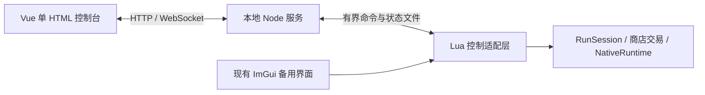

# Vue 单 HTML 游戏控制台可行性调研

日期：2026-10-27。范围：调研与架构建议；未部署通信脚本、未重载游戏、未修改现有游戏逻辑。通信延迟与性能尚未经游戏实测。

## 结论

可行。建议保留现有 TypeScript → Lua 的权威游戏逻辑，增加统一命令入口和只读状态快照，前端使用 Vite + Vue，构建为单个 HTML。

当前阶段优先采用“本地 Node 小服务 + 有界文件信箱”。HTTP/WebSocket 在游戏进程外运行，Lua 仅在既有更新回调中限频收命令、执行操作和发布简短状态。它需要额外启动本地服务；单 HTML 只描述前端交付格式，不代表整个控制系统只有一个文件。

如果明确要求启动游戏即自动提供网页、完全不需要外部服务，则改选“REFramework 原生通信插件 + Lua”。这更接近最终集成形态，但应先做最小通信验证，不能直接假设网上 LuaSocket DLL 能在当前嵌入式 Lua 中加载。

## 核实到的依据

### 实际安装版本

游戏日志记录 REFramework v1.5.9 + 7 commits，commit 为 `5bae4701396248a776c1de19f5be9552022295d5`。已下载对应源码到被忽略的 `.local/web-console-research/installed-*`，没有仅依据当前 master 推断本机能力。

- [对应版本 ScriptRunner.cpp](https://github.com/praydog/REFramework/blob/5bae4701396248a776c1de19f5be9552022295d5/src/mods/ScriptRunner.cpp)：初始化标准库与 sdk/imgui/json/fs 等绑定，没有发现内置 HTTP/WebSocket 服务绑定；`os.execute` 和 `os.rename` 被禁用。
- [对应版本 FS.cpp](https://github.com/praydog/REFramework/blob/5bae4701396248a776c1de19f5be9552022295d5/src/mods/bindings/FS.cpp)：提供数据目录中的同步读写，移除了 `io.popen`。因此不能直接让 Lua 用普通 shell 命令启动后台服务。
- [对应版本 Json.cpp](https://github.com/praydog/REFramework/blob/5bae4701396248a776c1de19f5be9552022295d5/src/mods/bindings/Json.cpp)：`dump_file` 使用普通文件流重写，不是原子发布；文件信箱必须处理读写竞争。`load_string` 可用于解析已限长读取的内容，解析失败不会像 `load_file` 那样自动记录每次 JSON 错误。
- [REFramework 官方项目文档](https://cursey.github.io/reframework-book/index.html)：支持原生插件和 Lua `require` 原生 DLL。可扩展网络能力，但不等于内置 LuaSocket。
- [回调文档](https://cursey.github.io/reframework-book/api/re.html)：`on_frame` 每帧调用，建议减少游戏方法调用。通信处理必须有预算；网络线程不得直接执行现有游戏调用。

“纯现有 Lua 环境直接启动完整 Web 后端”缺少现成网络接口的依据；“Lua 执行业务，通过桥接与网页通信”则具有明确可用的基础接口。

### 单 HTML 前端

[vite-plugin-singlefile 作者仓库](https://github.com/richardtallent/vite-plugin-singlefile)明确支持将 JS/CSS 内联到 HTML，并给出 Vue 插件组合示例。需避免 CDN、外置字体、public 中遗漏的资源和多入口产物；构建验收应检查最终目录确实仅有 HTML。

建议由本地服务提供这个 HTML，通过 `http://127.0.0.1:端口` 打开；开发期使用 Vite 代理。双击 HTML 可用于离线预览，但连接游戏仍需要服务，并额外涉及浏览器源与本地网络访问限制，不作为第一版连接方式。[浏览器同源规则](https://developer.mozilla.org/en-US/docs/Web/Security/Defenses/Same-origin_policy)

### 当前工程

- `src/game/main.ts:14` 仅启动时读取配置，随后建立 Core/Session/Runtime。
- `src/game/hud.ts` 按钮已直接调用 `session.start/choose/stop/retryPost` 和测试工具，适合抽出统一控制接口。
- `src/game/shop_window.ts` 把排队、真实发货、PT 回滚和界面绘制放在同一个类中。迁移前要抽出交易服务，网页和 ImGui 共用它，不能网页直接调用 `core.buy()` 绕开发货与读回。
- `src/core/run_core.ts:18` 同时双怪的奖励/HP/伤害补偿仍为代码常量；不是所有策划参数都已配置化。
- `src/core/run_session.ts` 保存出场计划和会话状态，`NativeRuntime` 保存原生计划。直接改配置文件不会使这些缓存自动一致更新。
- 现有报表是诊断文件，缺少命令确认、版本和稳定状态协议，不适合直接作为控制 API。

## 路线比较

| 路线 | 额外依赖 | 主要收益 | 主要代价 | 建议 |
|---|---|---|---|---|
| LuaSocket + Lua HTTP/WebSocket 服务 | 与嵌入式 Lua 兼容的原生模块 | 服务随游戏运行 | ABI/导出符号/模块搜索路径需验证；非阻塞收发与协议维护仍要做 | 可研究，不作为默认起点 |
| 原生通信插件 + Lua 命令队列 | 自制 REFramework DLL | 可在后台处理网络，避免持续文件传输 | 编译部署、生命周期、线程队列与重载清理成本 | 无外部服务要求下优先 |
| 本地 Node 服务 + Lua 文件信箱 | Node 服务进程 | 与现有 TS 工程接近，无需改框架或引入游戏内 DLL | 有同步小文件 I/O，速度与尾延迟必须测量 | 当前第一版推荐 |

Node 的 HTTP 服务能力有[官方文档](https://nodejs.org/api/http.html)。浏览器与 Node 之间可用 HTTP 命令 + WebSocket 状态推送；Node 与 Lua 的第一版传输仍是文件，不能把它描述成端到端 WebSocket。

## 推荐分工

Lua 是真实状态和执行结果的权威；Node 负责通信、静态页面、预设文件与记录；Vue 展示状态、编辑草稿、发出命令。前端与本地服务均不自行结算 PT，不直接写游戏内存。

项目可新增 `console/`、`bridge/`、不依赖浏览器/Node/REFramework 的 `protocol/`，游戏适配继续放在 `src/game/`。分开 tsconfig，避免 Vue/Node 代码被现有 TSTL 打包。

## 必须定义的协议

- 命令包含协议版本、桥接会话 ID、request ID、预期状态版本、目标任务 unique、操作和参数。Lua 执行时再次验证当前阶段与任务身份，避免旧页面按钮影响新任务。
- 命令返回 queued / applied / rejected / uncertain。点击成功、写入成功和游戏效果成功是不同状态；购物继续原生数量读回。
- 使用有界串行执行队列与 request ID 去重；刷新、重连不能重复发货。脚本重置后生成新会话 ID，使旧待办失效。对重置前未确认的发货显示结果不明，禁止自动重放，不能承诺跨崩溃 exactly-once。
- 状态只包含普通数据，不暴露托管对象和内存地址。包括会话阶段、层数、PT、任务身份、各怪 UID/怪种/生死、选择项、商店资格与拒绝原因、有效配置版本、近期事件序号。
- 命令采用显式 `setInvincible(true)`，避免 `toggle` 在重试时反向操作。停止流程、购药等复用现有业务校验。
- 默认服务仅监听 127.0.0.1，检查 Host/Origin，使用会话凭证和命令白名单。局域网协作另行设计；本控制台不等于游戏多人同步。

## 实时调参的生效范围

| 数据 | 建议生效点 |
|---|---|
| 展示、筛选、预览 | 网页立即生效 |
| 无敌等已有运行时测试开关 | 命令执行后回读 |
| 商店价格 | 无未决交易的整备阶段提交，版本固定到交易结束 |
| 波次 HP/伤害、奖励、怪池、同时双怪补偿 | 整备阶段提交，生成下一份选择/波次计划时生效 |
| 开局 PT、最大猫车等局规则 | 下一局生效 |
| 任务模板、地图及已加载怪物的资源信息 | 限制新任务/新局生效 |
| 当前活怪 HP/体型/攻击 | 独立实验功能，逐项验证后开放 |

第一版不承诺改滑块立即改变当前活怪。当前层的奖励随波次计划冻结，不能在击杀前改配置影响同一波结算。修改使用“草稿 → 校验 → 提交版本”，显示预计与实际生效点，并支持导入/导出预设。

## 性能与文件一致性

- 初始目标：有客户端时最多 5 Hz 命令检查和小状态采样；展示延迟目标 200–500 ms，属于验收目标而非已测结果。暂停/失焦不更新时显示 stale，不用旧状态冒充实时。
- 限频检查必须在游戏对象读取之前。复用运行时已采样的数据，不能网页每连接一次就多遍历一遍怪物。
- 简短状态以不超过 16 KiB 为初始预算，变化时发布；按 5 Hz 全部变化估算最多约 80 KiB/s 状态负载，实际文件系统成本需测，不能凭字节量保证不卡。
- 命令和状态各有固定容量；大配置按提交事件传输，不随遥测反复发送。旧事件只按序号增量传送，滚动保留有限条数。
- Node 到 Lua 的文件由 Node 临时写入后替换，遇 Windows 文件占用限次重试。Lua 到 Node 不能依赖被禁用的 `os.rename`，可使用固定双缓冲槽及版本/完整性校验，读取不完整时保留上一有效状态并稍后重读。
- 命令文件限长后读取，用 `fs.read + json.load_string` 容忍读写竞争；不循环调用会自动刷错误日志的解析入口。不递归扫描 data 目录。
- 页面关闭或桥接心跳失效后，停止高频发布；断连不停止游戏。诊断落盘独立限频，网络遥测不等于持续日志归档。
- 验收需比较关闭控制台、连接空闲、持续战斗、快速调参四种情况下的帧时间分位数、通信耗时、I/O 和日志增长。达不到预算再替换为原生通信插件，保留上层协议。

## 实施顺序与最小验收

1. 先做一条最小链路：读层数/PT/任务身份 → 页面设置无敌 → Lua 执行 → 页面收到确认；检查断连、脚本重置和帧时间。暂不搬全部 UI。
2. 抽统一命令层和商店交易层，迁移开局、三选一、购物、停止；ImGui 与网页共用行为，保留游戏内连接状态和停止入口。
3. 增加策划参数草稿、校验、生效点、预设导入导出和有效数值回读，把代码中的平衡常量配置化。
4. 用当前漏刷第二只、HP 异常问题验收观测面板：同时显示计划倍率、原生倍率、最终 HP、登记 UID 和加载阶段。这是提高后续研究效率的实际用途。

完成第 1 步之前，只能称方案有代码依据，不能宣称 Lua 与网页通信已在本机打通。HTML 属于外部浏览器界面，若以后要求直接嵌在游戏画面中，需额外的 WebView/渲染集成，不包含在本方案内。
